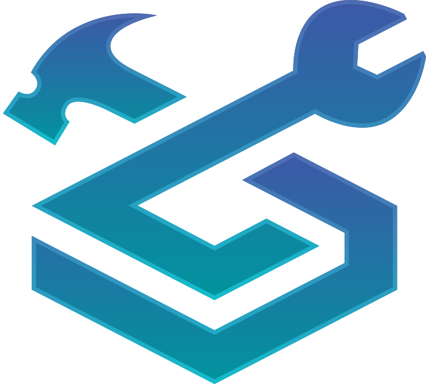
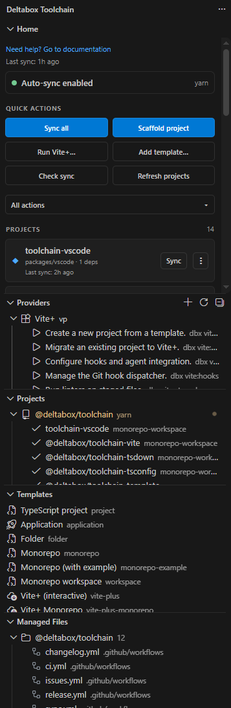
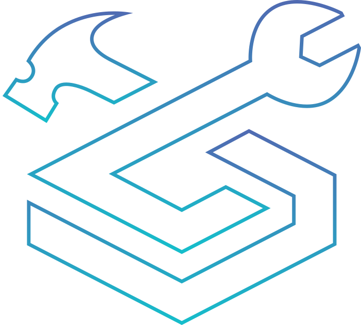

<div align="center">
  
</div>

# deltabox toolchain

[](./package.json)
[](https://github.com/deltabox-studio/toolchain/actions/workflows/ci.yml)
[](https://www.npmjs.com/package/@deltabox/toolchain)

**deltabox toolchain** is a superset of [Vite+](https://viteplus.dev) with:

- Project synchronization
- Config generator
- Tsconfig management
- MCP server
- CI/changelog automation
- Providers
- Catalogs
- A VS Code extension
- And more...

Use it as a Vite/Vite+ plugin or standalone `dbx.config.*`.

See the [list of features](#features) below.

See [CHANGELOG.md](/CHANGELOG.md) for latest updates.

Documentation, guides and examples at [toolchain.deltabox.studio](https://toolchain.deltabox.studio).

## Why use this?

Curious what the toolchain fixes and who it is for? Read
[Why use this?](https://toolchain.deltabox.studio/guide/why-use-this) for the
problems it removes, the core features and when it might not fit.

## Table of contents

- [deltabox toolchain](#deltabox-toolchain)
    - [Why use this?](#why-use-this)
    - [Table of contents](#table-of-contents)
    - [Features](#features)
    - [Install](#install)
    - [Quickstart](#quickstart)
    - [Config generator](#config-generator)
    - [Vite / Vite+ plugin](#vite--vite-plugin)
    - [MCP](#mcp)
    - [CLI](#cli)
    - [Programmatic API](#programmatic-api)
    - [VS Code extension](#vs-code-extension)
    - [Contribute](#contribute)
    - [Troubleshooting](#troubleshooting)
    - [License](#license)

## Features

- **Project synchronization**
- **Config-driven**
- **Config generator**
- **Vite / Vite+ plugin (optional)**
- **Changelogs & releases**
- **CI automation**
- **tsconfig management**
- **Providers**
- **Catalogs**
- **Templates**
- **Migrations**
- **MCP server**
- **VS Code extension**
- **Editor first**
- **Monorepo aware**

See more at [toolchain.deltabox.studio](https://toolchain.deltabox.studio).

The video and screenshot below is the VS Code extension. Read more about it at [toolchain.deltabox.studio/guide/vscode](https://toolchain.deltabox.studio/guide/vscode).

https://github.com/user-attachments/assets/a4f1ad75-fedd-40ee-b84d-3365f7025a3e

<div align="left">
  
</div>

## Install

```sh
# as a dev dependency in the project you want to manage
yarn add -D @deltabox/toolchain

# or for global usage
npm install -g @deltabox/toolchain
```

The package exposes one binary, `dbx`:

```sh
yarn dbx --help
```

## Quickstart

```sh
# 1. Write a dbx.config.ts for the current project
dbx project:config

# 2. Generate / refresh every managed file (adds .dbx/toolchain/manifest.json)
dbx sync

# 3. Verify in CI — fails when files are out of date
dbx sync --check
```

A minimal config:

```ts
import { defineConfig } from '@deltabox/toolchain';

export default defineConfig({
    toolchain: {
        project: { type: 'monorepo-root', name: 'myapp', scope: '@org' },
        changelog: { workflows: { ci: true, release: true } },
        tsconfig: { refs: true },
        biome: true,
        vite: { fmt: { semi: true, singleQuote: true } },
    },
});
```

The `@deltabox/toolchain` settings live under the `toolchain` key. Every section
there is **opt-in by presence**: `section: true` enables it with defaults,
`section: false` disables it, and `section: { ... }` configures it.
See the [configuration reference](https://toolchain.deltabox.studio/config/reference).

v3 adds a top-level [`toolchain.enabled`](https://toolchain.deltabox.studio/guide/migrations/v2-v3#toolchain-enable-disable)
switch, a per-section `regenerate` flag, lifecycle
[hooks](https://toolchain.deltabox.studio/guide/config/hooks) (`beforeVersion` /
`afterVersion`) and [Dependabot security
updates](https://toolchain.deltabox.studio/guide/ci/dependabot)
(`ci.dependabot.security`).

## Config generator

The same Zod-first approach powers a standalone config engine. Describe your
config once and generate `.env.example`, a JSON Schema, a markdown reference, TS
types and CLI flags from it — no hand-maintained docs to drift:

```ts
import { z } from 'zod';

import { createConfigEngine } from '@deltabox/toolchain/config';

export const engine = createConfigEngine({
    schema: {
        server: z.object({
            port: z.number().default(3000).meta({ envName: 'MYAPP_PORT' }),
        }),
    },
    envPrefix: 'MYAPP_',
    baseGroup: 'base',
    root: process.cwd(),
});

await engine.jsonSchema.write({ output: 'config.schema.json' });
engine.env.write({ output: '.env.example' });
engine.markdown.write({ outputDir: 'docs/reference/configuration' });
```

It also generates the TypeScript types — named interfaces with jsdoc from
`.describe()`, where unions and nested objects stay named instead of being
inlined:

```ts
engine.types.write({ outputDir: 'types' });
```

```ts
// types/server.ts
export interface ServerConfig {
    /** HTTP port. */
    port?: number;
}
```

At runtime the same package loads it back: `parseEnvConfig`, `parseCliConfig`
and `parseConfig` read the declared `envName`s and CLI flags, merge overrides
and validate the result through the schema, so it matches the generated types:

```ts
import { parseCliConfig, parseConfig, parseEnvConfig } from '@deltabox/toolchain/config';

// env only: MYAPP_PORT=8080 -> { port: 8080, host: '0.0.0.0' }
const fromEnv = parseEnvConfig(serverSchema, process.env, { envPrefix: 'MYAPP_' });

// env + CLI (`--port 8080`), with overrides merged on top
const config = parseConfig(serverSchema, { host: '127.0.0.1' }, { envPrefix: 'MYAPP_' });

// CLI only, from an explicit argv
const fromCli = parseCliConfig(serverSchema, process.argv.slice(2), { envPrefix: 'MYAPP_' });
```

Pass the engine's full `schema` instead of one scope to get the nested
`{ server: { ... } }` shape. Env typings are generated the same way
(`engine.env.types.write()`, which writes `env.ts` and the ambient
`dbx-env.d.ts`). For file-backed configs, `loadConfig` / `loadConfigAsync`
discover and import `dbx.config.*` (TS, JS, JSON or YAML) and resolve it through
the same schema.

See the [config generator
guide](https://toolchain.deltabox.studio/guide/config-generator) for loading,
overriding and validating the config.

The toolchain generates its own config types this way — see
`packages/shared/src/config-types.ts` and the [config generator
guide](https://toolchain.deltabox.studio/guide/config-generator#generated-outputs).

`configCommands({ engine })` also exposes the same generators as `config:*`
commands on your own CLI. See the [config generator
guide](https://toolchain.deltabox.studio/guide/config-generator).

## Vite / Vite+ plugin

`@deltabox/toolchain` ships a Vite/Vite+ plugin, so a Vite project can use dbx
without a separate `dbx.config.*` or a separate `dbx sync` step. Put the
toolchain config inline in the plugin:

```ts
// vite.config.ts
import { defineConfig } from 'vite-plus'; // or 'vite'

import { dbx, DBX_TASKS } from '@deltabox/toolchain/vite';

export default defineConfig({
    plugins: [
        dbx({
            toolchain: {
                project: { name: 'my-app', scope: '@org' },
                fmt: { oxc: true },
                lint: { oxc: true },
                ci: { sync: true },
                changelog: { preset: 'conventional' },
            },
        }),
    ],
    run: { tasks: { ...DBX_TASKS } },
    // your usual Vite / Vite+ config
});
```

- The `dbx()` plugin carries the toolchain config inline. The CLI reads it back
  from `vite.config.*`, so `dbx sync`, `dbx projects`, the VS Code extension and
  every other dbx command work with **plugin-only** projects. A `dbx.config.*`
  is optional, and if both exist the plugin config is merged on top.
- The plugin derives Vite options from the dbx sections: `logger` drives
  `logLevel`/`customLogger`, `watch` drives `server.watch`, and (on Vite+ only)
  `fmt`/`lint` drive the Vite+ formatter/linter. Pure Vite works without any
  Vite+ API.
- dbx never manages `vite.config.*` in plugin mode — the plugin lives there.
- The plugin runs `dbx sync` before the dev server / build, or `dbx sync --check`
  in CI (which fails the build when generated files are out of date), and
  re-syncs when a `vite.config.*`, `dbx.config.*` or `tsconfig.*.json` input
  changes.
- `run: { tasks: { ...DBX_TASKS } }` additionally exposes `vp run dbx:sync` /
  `vp run dbx:check` (Vite+ reads `run.tasks` from the static config, which a
  plugin cannot add). Drop the `run` block if you don't want those tasks.

See the [providers guide](https://toolchain.deltabox.studio/guide/providers).

## MCP

Every public dbx capability is also available over MCP. Run the server directly:

```sh
dbx mcp:serve
```

or install it (with a `deltabox` skill) into your AI harness/editor:

```sh
dbx mcp:install --provider claude
dbx mcp:install --provider vscode --scope global
```

Builtin providers: `claude`, `codex`, `vscode`, `opencode`, `pi`, and `custom`
(a directory you choose). `dbx mcp:list` prints the exact files. The VS Code
extension exposes the same installer from its command palette.

## CLI

Visit the [CLI docs](https://toolchain.deltabox.studio/guide/cli) to learn more.

Note: Commands that run against a project load its `dbx.config.ts` first, so
config-derived defaults apply unless overridden on the command line.

## Programmatic API

```ts
import { defineConfig, loadToolchainConfig, runSync, defaultSyncTasks } from '@deltabox/toolchain';

const { config, tokens, projectType } = await loadToolchainConfig(process.cwd());
await runSync({ tasks: defaultSyncTasks(), cwd: process.cwd(), config, tokens, projectType });
```

## VS Code extension

Download from the [Visual Studio Code Marketplace](https://marketplace.visualstudio.com/items?itemName=deltabox.toolchain-vscode).

or through the CLI:

```sh
code --install-extension deltabox.toolchain-vscode
```

See [packages/vscode/README.md](./packages/vscode/README.md) to learn more about how it works.

## Contribute

Feel free to contribute to the development or docs.

Visit [toolchain.deltabox.studio/contribute/](https://toolchain.deltabox.studio/contribute/) for more information.

## Troubleshooting

Please create an [issue ticket](https://github.com/deltabox-studio/toolchain/issues) to report bugs or ask questions.

Make sure to search for existing open/closed issues with the same problem as yours before creating a new issue.

## License

[MPL-2.0](./LICENSE) © deltabox

<div align="center">
  
</div>
