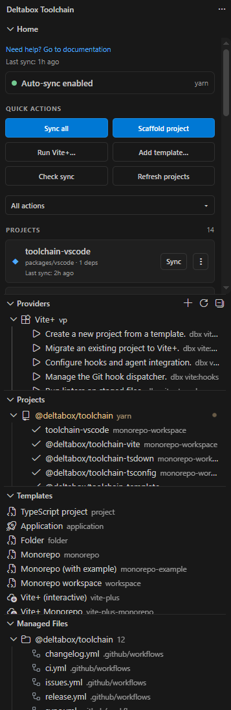

# deltabox toolchain

[](./package.json)
[](https://github.com/deltabox-studio/toolchain/actions/workflows/ci.yml)
[](https://www.npmjs.com/package/@deltabox/toolchain)

All-in-one, config-driven dev toolchain: scaffold projects, generate and manage configs, tsconfigs, syncing, changelogs and CI, run Vite+, and migrations.

- Save and use templates (local/remote) so you never have to scaffold the same projects over and over again.
- Generate config types, env variables, cli flags, markdown and JSON schemas, so your codebase stays consistent, validated and well-documented.
- Simply extend or setup CI for your changelogs, releases, issues etc.
- Sync your entire project so workspaces, docs and CI are always up-to-date.
- Plug it into Vite / Vite+ and streamline your DX for your existing Vite setup.

See the [list of features](#features).

<div align="left">
  
</div>

What you see above is the VS Code extension. Read more about it at [toolchain.deltabox.studio/guide/vscode](https://toolchain.deltabox.studio/guide/vscode).

See [CHANGELOG.md](/CHANGELOG.md) for latest updates.

Documentation, guides and examples at [toolchain.deltabox.studio](https://toolchain.deltabox.studio/guide).

## Table of contents

- [deltabox toolchain](#deltabox-toolchain)
    - [Table of contents](#table-of-contents)
    - [Features](#features)
    - [Install](#install)
    - [Quickstart](#quickstart)
    - [Config generator](#config-generator)
    - [Vite / Vite+ plugin](#vite--vite-plugin)
    - [CLI](#cli)
    - [Programmatic API](#programmatic-api)
    - [VS Code extension](#vs-code-extension)
    - [Development](#development)
    - [Docs](#docs)
    - [License](#license)

## Features

- **Config-driven**
- **Config generator**
- **Vite / Vite+ plugin**
- **Changelogs & releases**
- **tsconfig generation**
- **Providers**
- **Templates**
- **Migrations**
- **Editor first**
- **Monorepo aware**
- **Auto sync**

See more at [toolchain.deltabox.studio](https://toolchain.deltabox.studio).

## Install

```bash
# as a dev dependency in the project you want to manage
yarn add -D @deltabox/toolchain

# or for global usage
npm install -g @deltabox/toolchain
```

The package exposes one binary, `dbx`:

```bash
yarn dbx --help
```

## Quickstart

```bash
# 1. Write a dbx.config.ts for the current project
dbx project:config

# 2. Generate / refresh every managed file (adds .dbx/toolchain/manifest.json)
dbx sync

# 3. Verify in CI — fails when files are out of date
dbx sync --check
```

A minimal config:

```ts
import { defineConfig } from '@deltabox/toolchain';

export default defineConfig({
    toolchain: {
        project: { type: 'monorepo-root', name: 'acme', scope: '@acme' },
        changelog: { workflows: { ci: true, release: true } },
        tsconfig: { refs: true },
        biome: true,
        vite: { fmt: { semi: true, singleQuote: true } },
    },
});
```

The `@deltabox/toolchain` settings live under the `toolchain` key. Every section
there is **opt-in by presence**: `section: true` enables it with defaults,
`section: false` disables it, and `section: { ... }` configures it.
See the [configuration reference](https://toolchain.deltabox.studio/config/reference).

## Config generator

The same Zod-first approach powers a standalone config engine. Describe your
config once and generate `.env.example`, a JSON Schema, a markdown reference, TS
types and CLI flags from it — no hand-maintained docs to drift:

```ts
import { z } from 'zod';

import { createConfigEngine } from '@deltabox/toolchain/config';

export const engine = createConfigEngine({
    scopes: {
        server: {
            zodSchema: z.object({
                port: z.number().default(3000).meta({ env: 'MYAPP_PORT' }),
            }),
        },
    },
    envPrefix: 'MYAPP_',
    baseGroup: 'base',
    root: process.cwd(),
});

await engine.writeJsonSchema({ output: 'config.schema.json' });
engine.writeEnvFile({ output: '.env.example' });
engine.writeMarkdown({ outDir: 'docs/reference/configuration' });
```

It also generates the TypeScript types — named interfaces with jsdoc from
`.describe()`, where unions and nested objects stay named instead of being
inlined:

```ts
engine.writeConfigTypes({ outputDir: 'types' });
```

```ts
// types/server.ts
export interface ServerConfig {
    /** HTTP port. */
    port?: number;
}
```

At runtime the same package loads it back — `parseEnvTree` folds the `PREFIX_*`
variables into a tree and the typed accessors read it (schema validation is just
a `.parse()` away):

```ts
import { envInt, envString, parseEnvTree } from '@deltabox/toolchain/config';

const tree = parseEnvTree(process.env, 'MYAPP_');
const port = envInt(tree, 'port', 3000);
const host = envString(tree, 'host', '0.0.0.0');
```

See the [config generator
guide](https://toolchain.deltabox.studio/guide/config-generator) for loading,
overriding and validating the config.

The toolchain generates its own config types this way — see
`packages/shared/src/config-types.ts` and the [config generator
guide](https://toolchain.deltabox.studio/guide/config-generator#generated-outputs).

`configCommands({ engine })` also exposes the same generators as `config:*`
commands on your own CLI. See the [config generator
guide](https://toolchain.deltabox.studio/guide/config-generator).

## Vite / Vite+ plugin

`@deltabox/toolchain` ships a Vite plugin, so a Vite (or Vite+) project can run
dbx as part of its own pipeline — no separate `dbx sync` step:

```ts
// vite.config.ts
import { defineConfig } from 'vite'; // or 'vite-plus'

import { dbx, DBX_TASKS } from '@deltabox/toolchain/vite';

export default defineConfig({
    plugins: [dbx()],
    run: { tasks: { ...DBX_TASKS } },
    // your usual Vite / Vite+ config
});
```

- The `dbx()` plugin runs `dbx sync` before the dev server / build, or
  `dbx sync --check` in CI (which fails the build when generated files are out of
  date), and re-syncs when a `dbx.config.*` / `tsconfig.*.json` input changes.
- `run: { tasks: { ...DBX_TASKS } }` additionally exposes `vp run dbx:sync` /
  `vp run dbx:check` (Vite+ reads `run.tasks` from the static config, which a
  plugin cannot add). Drop the `run` block if you don't want those tasks.

See the [providers guide](https://toolchain.deltabox.studio/guide/providers).

## CLI

Visit the [CLI docs](https://toolchain.deltabox.studio/guide/cli) to learn more.

Note: Commands that run against a project load its `dbx.config.ts` first, so
config-derived defaults apply unless overridden on the command line.

## Programmatic API

```ts
import { defineConfig, loadToolchainConfig, runSync, defaultSyncTasks } from '@deltabox/toolchain';

const { config, tokens, projectType } = await loadToolchainConfig(process.cwd());
await runSync({ tasks: defaultSyncTasks(), cwd: process.cwd(), config, tokens, projectType });
```

## VS Code extension

Download from the [Visual Studio Code Marketplace](https://marketplace.visualstudio.com/items?itemName=deltabox.toolchain-vscode).

or through the CLI:

```bash
code --install-extension deltabox.toolchain-vscode
```

See [packages/vscode/README.md](./packages/vscode/README.md) to learn more about how it works.

## Development

This repo is a Yarn 4 workspace; Vite+ (`vp`) drives format, lint, test and the
task runner from the root `vite.config.ts`.

```bash
yarn install        # fresh checkout
yarn build          # packages via `vp run` + root tsdown
yarn test           # package + root tests
yarn typecheck      # packages + root
yarn check          # Oxfmt + Oxlint (format + lint)
yarn format         # `vp fmt`
yarn lint           # `vp lint --fix`
```

> `vp` resolves only at the repo root, so run these from the root. Package
> typechecks/tests resolve workspace deps from their built `dist`, so run a full
> `yarn build` after changing a package's public exports.

Docs live in `apps/docs` (VitePress): `yarn workspace @deltabox/toolchain-docs build`.

## Docs

Full documentation, guides and examples live at [toolchain.deltabox.studio](https://toolchain.deltabox.studio/guide).

The source pages live in `apps/docs`.

## License

[MPL-2.0](./LICENSE) © deltabox
